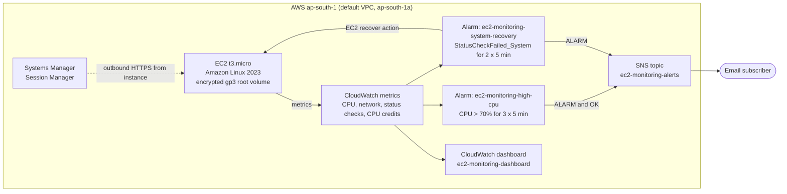
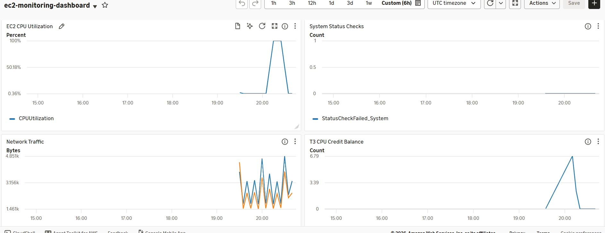

# EC2 Automated Monitoring and Self-Healing

> **Portfolio Project 03** of a 10-project DevOps and Cloud Engineering series.

A hands-on Terraform project that deploys an Amazon EC2 instance with CloudWatch monitoring, SNS email alerts, Systems Manager access, automatic recovery from system-level failures, and a CloudWatch dashboard, all in the AWS Mumbai region (`ap-south-1`).


---

## Table of Contents

1. [Project Objectives](#1-project-objectives)
2. [Architecture](#2-architecture)
3. [Features](#3-features)
4. [Repository Structure](#4-repository-structure)
5. [Resources](#5-resources)
6. [Monitoring and Self-Healing](#6-monitoring-and-self-healing)
7. [Prerequisites](#7-prerequisites)
8. [Configuration](#8-configuration)
9. [Deployment](#9-deployment)
10. [Testing Performed](#10-testing-performed)
11. [Screenshots](#11-screenshots)
12. [Security Considerations](#12-security-considerations)
13. [Cost Considerations](#13-cost-considerations)
14. [Cleanup](#14-cleanup)
15. [Known Limitations](#15-known-limitations)
16. [Future Improvements](#16-future-improvements)
17. [License](#17-license)

---

## 1. Project Objectives

- Deploy a monitored EC2 instance entirely with Terraform.
- Alert by email when CPU utilization stays high, and again when it returns to normal.
- Recover the instance automatically when AWS detects a system-level (underlying host) failure.
- Administer the instance through Systems Manager without opening SSH.
- Show instance health and performance on one CloudWatch dashboard.

## 2. Architecture



## 3. Features

- Launches an encrypted `t3.micro` EC2 instance in `ap-south-1`.
- Uses an IAM instance profile with `AmazonSSMManagedInstanceCore`.
- Allows Systems Manager access without opening inbound SSH (the security group has no inbound rules).
- Sends SNS email alerts when CPU utilization exceeds 70% for three consecutive five-minute periods.
- Sends an email when the CPU alarm returns to normal.
- Monitors `StatusCheckFailed_System`.
- Automatically recovers the EC2 instance after two failed system-status-check periods.
- Includes a CloudWatch dashboard for CPU, system status checks, network traffic, CPU credits and alarm status.

## 4. Repository Structure

```text
ec2-automated-monitoring-self-healing/
├── README.md
├── .gitignore
├── LICENSE                         # MIT License
├── screenshots/
│   └── cloudwatch-dashboard.png
└── terraform/
    ├── provider.tf                 # AWS provider (~> 6.0), region, default tags
    ├── variables.tf                # Input variables
    ├── main.tf                     # Default VPC/subnet lookup, AMI, security group, EC2
    ├── iam.tf                      # IAM role and instance profile for SSM
    ├── monitoring.tf               # SNS, CloudWatch alarms, dashboard
    ├── outputs.tf                  # Instance, SNS, alarm and dashboard outputs
    ├── terraform.tfvars.example    # Copy to terraform.tfvars
    └── .terraform.lock.hcl         # Provider lock (hashicorp/aws 6.72.0)
```

Not committed (excluded by `.gitignore`): `terraform.tfvars`, `*.tfstate*`, `*.tfplan`, `.terraform/`.

## 5. Resources

| File | Resource | Details |
|---|---|---|
| `main.tf` | `data.aws_vpc.default` | Existing default VPC |
| `main.tf` | `data.aws_subnet.selected` | Default subnet in `<region>a` |
| `main.tf` | `data.aws_ami.amazon_linux` | Latest Amazon Linux 2023 x86_64 AMI |
| `main.tf` | `aws_security_group.ec2_sg` | `ec2-monitoring-sg`; no inbound rules; outbound TCP 443 only |
| `main.tf` | `aws_instance.monitoring_ec2` | `t3.micro`, public IP, SSM instance profile, 8 GB encrypted `gp3` root volume, Apache installed by user data |
| `iam.tf` | `aws_iam_role.ec2_ssm_role` | `ec2-monitoring-ssm-role`, trusted by EC2 |
| `iam.tf` | `aws_iam_role_policy_attachment.ssm_policy` | `AmazonSSMManagedInstanceCore` |
| `iam.tf` | `aws_iam_instance_profile.ec2_ssm_profile` | `ec2-monitoring-ssm-profile` |
| `monitoring.tf` | `aws_sns_topic.alerts` | `ec2-monitoring-alerts` |
| `monitoring.tf` | `aws_sns_topic_subscription.email` | Email endpoint from `var.alert_email` |
| `monitoring.tf` | `aws_cloudwatch_metric_alarm.high_cpu` | `ec2-monitoring-high-cpu` |
| `monitoring.tf` | `aws_cloudwatch_metric_alarm.system_recovery` | `ec2-monitoring-system-recovery` |
| `monitoring.tf` | `aws_cloudwatch_dashboard.main` | `ec2-monitoring-dashboard` |

The provider adds default tags to every resource: `Project`, `Environment = dev`, `ManagedBy = Terraform`.

## 6. Monitoring and Self-Healing

### Alarms

| Alarm | Metric | Statistic | Condition | Evaluation | Actions |
|---|---|---|---|---|---|
| `ec2-monitoring-high-cpu` | `CPUUtilization` | Average | `> 70` | 3 of 3 periods of 300 s | SNS on `ALARM` and on `OK` |
| `ec2-monitoring-system-recovery` | `StatusCheckFailed_System` | Minimum | `>= 1` | 2 of 2 periods of 300 s | SNS + `arn:aws:automate:<region>:ec2:recover` |

Missing data: `notBreaching` for the CPU alarm, `missing` for the recovery alarm.

### How recovery works

`StatusCheckFailed_System` reports problems with the AWS hardware or network behind the instance, not with the operating system or application. When the recovery alarm fires, the EC2 **recover** action moves the instance to healthy hardware. The instance keeps its instance ID, private IP address, Elastic IP addresses and instance metadata. Data in memory is lost, because the instance is restarted.

Recovery does **not** fix problems inside the instance, such as a crashed application or a full disk. Those show up in `StatusCheckFailed_Instance`, which this project does not act on.

### Dashboard

| Widget | Metrics |
|---|---|
| EC2 CPU Utilization | `CPUUtilization` (Average) |
| System Status Checks | `StatusCheckFailed_System` (Maximum) |
| Network Traffic | `NetworkIn`, `NetworkOut` (Average) |
| T3 CPU Credit Balance | `CPUCreditBalance` (Average) |
| Monitoring Alarm Status | Both alarms |

## 7. Prerequisites

- An AWS account with permissions for EC2, IAM, Systems Manager, SNS and CloudWatch.
- AWS CLI configured (this project used a named profile, `terraform-bootstrap`).
- Terraform `>= 1.5.0`.
- A default VPC in the region, with a default subnet in the `a` Availability Zone.

## 8. Configuration

```powershell
cd terraform
Copy-Item terraform.tfvars.example terraform.tfvars    # Linux/macOS: cp terraform.tfvars.example terraform.tfvars
```

Set `alert_email` in `terraform.tfvars`:

```hcl
alert_email = "your-email@example.com"
```

| Variable | Default | Description |
|---|---|---|
| `aws_region` | `ap-south-1` | Region for all resources |
| `project_name` | `ec2-automated-monitoring` | Value of the `Project` tag |
| `instance_type` | `t3.micro` | EC2 instance type |
| `root_volume_size` | `8` | Root volume size in GB |
| `alert_email` | none (required) | Email address for alerts |

After deployment, **confirm the SNS subscription email**, or no alerts are delivered.

## 9. Deployment

```powershell
cd terraform
terraform init
terraform fmt -recursive
terraform validate
terraform plan -out=ec2-monitoring.tfplan
terraform apply ec2-monitoring.tfplan
terraform output
```

## 10. Testing Performed

The CPU alarm was tested through AWS Systems Manager by intentionally creating sustained CPU load.

Results verified:

- CPU utilization remained near 100%.
- CloudWatch triggered `ec2-monitoring-high-cpu`.
- SNS delivered an `ALARM` email notification.
- CPU load was stopped.
- CloudWatch returned the alarm to `OK`.
- SNS delivered the recovery notification.
- `t3.micro` automatic recovery support was confirmed.
- The recovery alarm was confirmed to use `StatusCheckFailed_System` and the EC2 recovery action.

A real system status check failure was **not** simulated, because it cannot be triggered from inside the instance.

## 11. Screenshots

### CloudWatch dashboard during the CPU load test



The CPU Utilization widget shows the load test pushing CPU to 100%, then dropping back after the load was stopped. System status checks stay at `0` (no hardware failure), and the network and CPU credit widgets show the instance's activity during the same window.

## 12. Security Considerations

- **No inbound access.** The security group has no inbound rules, so there is no SSH or other open port.
- **Session Manager instead of SSH.** Access uses IAM through the `AmazonSSMManagedInstanceCore` instance profile; no key pair is configured.
- **Restricted outbound traffic.** Only TCP 443 is allowed outbound, which covers Systems Manager and package repositories.
- **Encrypted storage.** The root `gp3` volume is encrypted.
- **No secrets in code.** The alert email is supplied through `terraform.tfvars`, which is not committed.

## 13. Cost Considerations

| Resource | Notes |
|---|---|
| EC2 `t3.micro` | Hourly charge; may be covered by the free tier if eligible. T3 instances run in unlimited mode by default, so sustained high CPU can add CPU credit charges |
| EBS `gp3` 8 GB | Per GB-month |
| Public IPv4 address | AWS charges for every public IPv4 address |
| CloudWatch | 2 alarms and 1 dashboard, within or near the free-tier allowance |
| SNS email | Negligible at this volume |

Check the [AWS Pricing Calculator](https://calculator.aws/) for current prices in `ap-south-1`.

## 14. Cleanup

```powershell
cd terraform
terraform destroy
```

Type `yes` to confirm. This deletes the instance, alarms, dashboard, SNS topic and IAM resources.

## 15. Known Limitations

- **Single instance.** Recovery restores the same instance on new hardware; there is no load balancer or second instance for availability.
- **System failures only.** The recovery alarm acts on `StatusCheckFailed_System`. Instance-level failures (`StatusCheckFailed_Instance`) and application failures are not handled.
- **Public IP required.** The instance uses a public IP in the default VPC to reach Systems Manager, because there are no VPC endpoints or NAT Gateway.
- **Apache is not reachable.** User data installs Apache, but the security group allows no inbound traffic.
- **Hard-coded names.** Resource names such as `ec2-monitoring-sg` are fixed instead of using `var.project_name`.
- **Local state.** Terraform state is stored locally.

## 16. Future Improvements

- Add a `StatusCheckFailed_Instance` alarm with a reboot action for instance-level failures.
- Install the CloudWatch agent for memory and disk metrics, with alarms on low disk space.
- Use VPC endpoints for Systems Manager and remove the public IP.
- Store state in an S3 backend and deploy through the Project 02 CI/CD pipeline.
- Derive resource names from `var.project_name`.

## 17. License

This project is licensed under the [MIT License](LICENSE).
